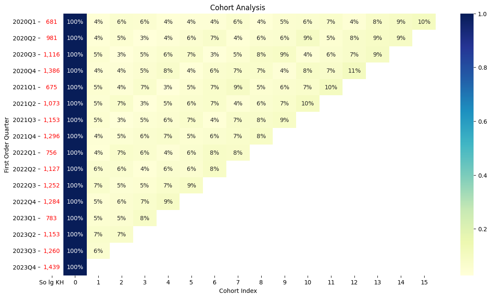
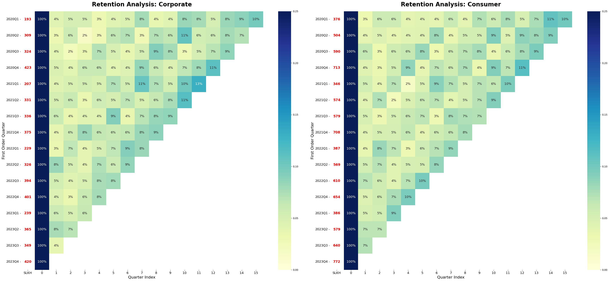
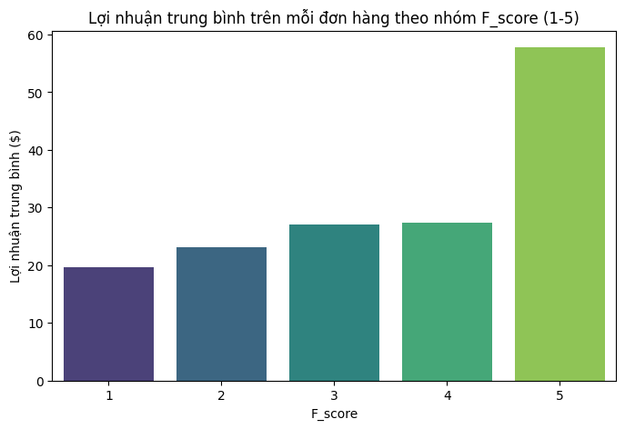

# Phân tích Cohort và Tỷ lệ giữ chân khách hàng cho doanh nghiệp thương mại điện tử

Dự án phân tích cohort theo quý trên **17.415 khách hàng** với dữ liệu giao dịch bốn năm (từ 2020 đến 2023). Mục tiêu là đo lường có bao nhiêu khách hàng quay lại sau lần mua đầu tiên, so sánh khả năng giữ chân giữa hai nhóm khách hàng Corporate và Consumer, đồng thời tìm hiểu mối liên hệ giữa tần suất mua hàng với thu nhập và lợi nhuận.

**Công nghệ sử dụng:** Python, pandas, NumPy, Matplotlib, Seaborn, Jupyter Notebook

## Câu hỏi nghiệp vụ

1. Có bao nhiêu khách hàng quay lại mua trong các quý sau lần mua đầu tiên, và tỷ lệ này khác nhau thế nào giữa các cohort?
2. Nhóm Corporate và nhóm Consumer có hành vi giữ chân khác nhau hay không?
3. Nhóm tần suất mua hàng nào mang lại lợi nhuận cao, và thu nhập hằng năm có giải thích được hành vi mua hàng hay không?

## Dữ liệu

* `EcomSales.csv`: giao dịch theo đơn hàng (mã đơn, khách hàng, ngày mua, số lượng, doanh thu, chiết khấu, lợi nhuận)
* `Customer.csv`: thông tin khách hàng (phân khúc, thu nhập hằng năm, trình độ học vấn, nghề nghiệp, v.v.)
* `Region.csv` và `products.csv`: được nạp vào notebook để tham khảo nhưng không dùng trong phân tích này

**Phạm vi:** từ quý 1 năm 2020 đến quý 4 năm 2023, gồm 16 cohort theo quý.
**Quy mô:** 25.719 bản ghi mua hàng duy nhất (theo khách hàng và ngày mua) từ 17.415 khách hàng.
**Nguồn dữ liệu:** [điền nguồn dữ liệu, giấy phép hoặc tên khóa học]

> Dữ liệu gốc chứa thông tin cá nhân như họ tên và email nên không được đưa lên repository này. Để chạy lại kết quả, hãy đặt các file CSV của bạn vào thư mục `data/`.

## Phương pháp

1. **Chuẩn bị dữ liệu:** ghép bảng giao dịch với bảng khách hàng, giữ lại `CustomerID` và `OrderDate`, loại bỏ dòng trùng, kiểm tra giá trị thiếu và chuyển ngày mua sang kiểu `datetime`.
2. **Xác định cohort:** mỗi khách hàng thuộc cohort ứng với quý của lần mua đầu tiên.
3. **Tính chỉ số cohort:** khoảng cách tính theo quý giữa mỗi lần mua và lần mua đầu tiên của khách hàng đó.
4. **Ma trận retention:** đếm số khách hàng duy nhất theo cohort và chỉ số quý, chia cho quy mô cohort (chỉ số 0), sau đó vẽ heatmap.
5. **So sánh phân khúc:** xây dựng ma trận tương tự riêng cho Corporate và Consumer, dùng chung thang màu từ 0% đến 25% để so sánh trực tiếp.
6. **Phân tích tần suất:** đếm số đơn hàng riêng biệt của mỗi khách hàng, chia thành năm nhóm điểm tần suất (F1 đến F5) theo các khoảng đều nhau, rồi so sánh thu nhập và lợi nhuận trung bình của từng nhóm.

Cách chia nhóm tần suất: F1 gồm khách mua 1 đến 2 đơn, F2 gồm 3 đến 4 đơn, F3 là 5 đơn, F4 gồm 6 đến 7 đơn và F5 gồm 8 đến 9 đơn.

## Kết quả chính

* **Quy mô cohort mang tính mùa vụ.** Các cohort quý 4 luôn lớn nhất (khoảng 1.284 đến 1.439 khách hàng mới), trong khi cohort quý 1 nhỏ nhất (khoảng 675 đến 783).
* **Tỷ lệ giữ chân nhìn chung thấp.** Chỉ khoảng 3,6% đến 6,7% khách hàng của mỗi cohort quay lại ở quý đầu tiên sau khi mua, và ở các quý sau tỷ lệ này chủ yếu dao động trong khoảng 3% đến 9%. Các cohort gần đây có tỷ lệ quay lại quý đầu tiên nhỉnh hơn một chút so với các cohort năm 2020.
* **Phần lớn khách hàng chỉ mua một lần.** 68,8% khách hàng chỉ đặt một đơn và 19,9% đặt hai đơn, nghĩa là chỉ khoảng 31% là khách hàng mua lại.
* **Hai phân khúc có mức giữ chân tương đương nhau.** Cả Corporate và Consumer đều quay lại ở mức khoảng 3% đến 9% mỗi quý, không có xu hướng giảm mạnh theo thời gian. Corporate đạt đỉnh cao hơn một chút ở các quý sau (tối đa 13%, so với 11% của Consumer), nhưng chênh lệch nhỏ và chưa được kiểm định thống kê. Điểm khác biệt rõ nhất là quy mô: mỗi cohort Consumer có 346 đến 772 khách hàng mới, còn Corporate có 193 đến 423.
* **Tần suất mua gắn với lợi nhuận.** Lợi nhuận trung bình trên mỗi dòng đơn hàng tăng từ khoảng 19,7 USD (F1) lên khoảng 27,4 USD (F4). Nhóm F5 đạt khoảng 57,8 USD nhưng chỉ có hai khách hàng, vì vậy không nên xem đây là một quy luật đáng tin cậy.
* **Thu nhập không giải thích được tần suất mua.** Thu nhập trung bình của F1 đến F3 khá gần nhau (khoảng 56.000 đến 57.000), nhóm F4 thấp nhất (khoảng 48.500), nghĩa là thu nhập cao hơn không đồng nghĩa với việc mua thường xuyên hơn.

Các lý giải theo mùa vụ như khuyến mãi cuối năm hay nhu cầu mua sắm dịp lễ là những giả thuyết hợp lý, nhưng chưa được kiểm chứng vì không có dữ liệu về chương trình khuyến mãi.

## Biểu đồ

### Retention theo cohort quý
Tỷ lệ khách hàng của mỗi cohort quay lại mua ở các quý sau. Số màu đỏ là quy mô cohort.



### Retention theo phân khúc khách hàng
Cohort của Corporate và Consumer trên cùng thang màu từ 0% đến 25%.



### Lợi nhuận trung bình theo nhóm tần suất
Lợi nhuận trung bình trên mỗi dòng đơn hàng của từng nhóm điểm tần suất. Nhóm F5 chỉ có hai khách hàng nên cần diễn giải thận trọng.



## Cấu trúc repository

```
├── Cohort_Analysis.ipynb
├── data/            # không đưa lên repo, tự thêm file CSV
├── images/          # các biểu đồ đã xuất
├── requirements.txt
└── README.md
```


## Hạn chế và hướng phát triển

* Retention hiện tính cả khách hàng mua lại ở bất kỳ quý nào sau đó, không chỉ ở các quý liên tiếp.
* Đơn vị theo quý che khuất hành vi ngắn hạn, có thể thử phân tích theo tháng.
* Bổ sung retention theo doanh thu và giá trị vòng đời khách hàng (CLV) theo từng cohort.
* Mở rộng sang phân khúc RFM với thêm hai chiều là mức độ gần đây và giá trị chi tiêu.
* Kiểm định thống kê để xác nhận sự khác biệt giữa Corporate và Consumer.


